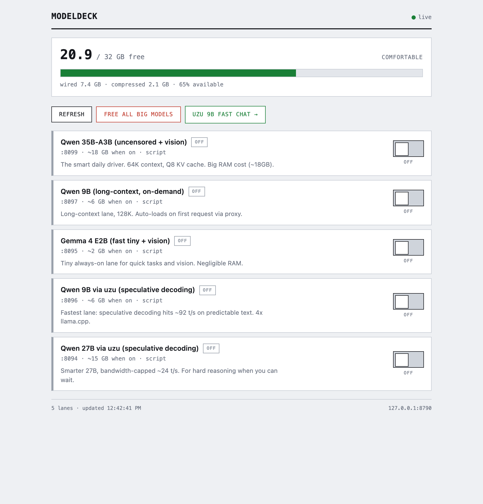
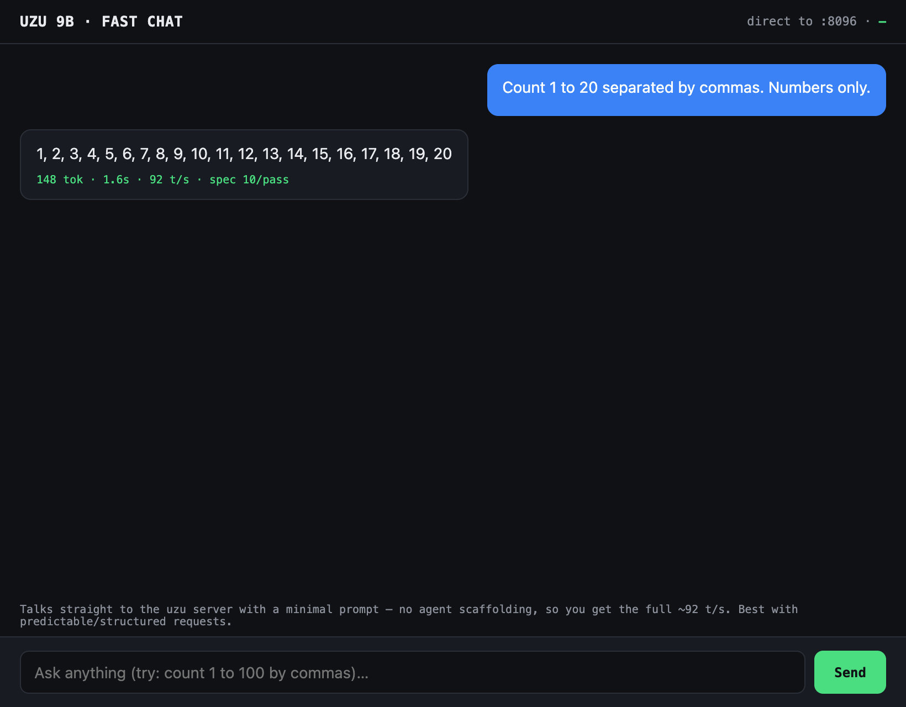

# Thrash

**Stop your RAM from thrashing.** A local control panel + macOS menu-bar app for
running multiple local LLM backends on one machine — one switch per model, so you
turn them on and off ad hoc without babysitting memory.



## The problem

Modern local inference has a spread of backends, each with real strengths:
**llama.cpp** (broad model support, long context), **LM Studio** (easy GUI +
vision), **MLX** (Apple-native), and **uzu** (speculative decoding — up to ~4×
faster on Apple Silicon). You want them all available. But running several in
parallel doesn't work on a real machine: a 35B at 64K wants ~18 GB, a 27B wants
~15 GB, and a 32 GB Mac has neither the RAM nor the patience for two at once.
Load too many and the whole box starts swapping — the machine thrashes, and
every lane crawls.

Thrash is the switchboard. Declare each backend once, then turn lanes on and off
ad hoc from a panel or the menu bar, with live free-memory so you can see the
cost before you commit to it. One big model at a time, deliberately — instead of
all of them at once, accidentally.

## Install

```bash
git clone <this repo> && cd thrash
./install.sh                 # preview the plan (no changes)
./install.sh --yes           # apply: config, menu-bar build, launchd
```

One command: it copies `config/config.example.json` to `config/config.local.json`
(never overwriting an existing one), builds the menu-bar app, and registers the
launchd agents that start the server and menu bar at login. Re-running is safe
and idempotent. `./install.sh --uninstall` stops the services and moves the
launchd plists to `~/Trash/hermes` (nothing is deleted). `./install.sh --help`
for details.

Then open <http://127.0.0.1:8790>.

## What it does

- **Control panel** (`web/panel.html`) — a switch per lane, live RAM with a
  low-memory warning, one-click start/stop, and a link into the streaming chat.
- **Menu-bar app** (`menubar/Thrash.swift`) — the same lanes in your menu bar,
  with an at-a-glance free-memory readout (🧠 comfortable / 🔥 tight).
- **Streaming chat** (`web/uzu-chat.html`) — a minimal chat that talks straight
  to a lane with a tiny prompt, so you see real throughput instead of
  agent-scaffolding overhead.



- **CLI** — `./thrash on|off|toggle|status [--json]|logs|doctor` for the same
  lanes from the terminal, including a `doctor` that checks your environment.
- **Idle auto-unload** — optionally stop lanes after a TTL of inactivity, so a
  forgotten lane doesn't hold RAM all day (off by default; enable in config).
- **RAM guard** — live free-memory readout and a low-memory warning before you
  commit to a big model.
- **Notifications** — macOS notifications when a lane finishes loading, or when
  free memory runs low.
- **Log viewer** — per-lane log tail in the panel and via `./thrash logs <id>`.
- **Chat lane-picker** — pick which lane the chat talks to.
- **One JSON API** — the panel, menu bar, and CLI share a single source of
  truth via the stdlib Python server.

## Why not just use LM Studio / Ollama?

Those are great *servers*. Thrash is a *control surface* that sits above whatever
you already run:

- **Backend-agnostic** — llama.cpp, uzu, MLX, LM Studio, anything with a
  `start`/`stop`/`status`. It doesn't replace them; it orchestrates them.
- **RAM-first** — every lane shows its approximate cost, and the panel warns
  before you overload the machine.
- **Menu bar** — toggle a lane without leaving whatever you're doing.
- **Direct-speed chat** — hit a lane with a minimal prompt and watch its true
  tok/s, instead of routing through a heavy agent stack.
- **Zero dependencies** — Python stdlib + plain HTML/JS + a small Swift binary.

## Architecture

```
server/thrash_server.py    stdlib HTTP control backend (the source of truth)
server/config.py           config loader (deep-merge + validation)
thrash                     CLI (on/off/status/logs/doctor)
lanes/*.sh                 one start/stop/status script per model lane
web/panel.html             control panel UI
web/uzu-chat.html          streaming chat UI
menubar/Thrash.swift       native menu-bar app (AppKit)
menubar/build.sh           compiles the binary + .app bundle
install.sh                 one-command setup (config + build + launchd)
config/config.example.json every machine-specific value lives here
```

No dependencies beyond Python 3 stdlib for the server, and Swift for the menu
bar. The web assets are plain HTML/CSS/JS.

## Quick start

The installer does steps 1–3 for you:

```bash
./install.sh --yes           # config + menu-bar build + launchd
open http://127.0.0.1:8790   # panel
./thrash status              # CLI view of the same lanes
```

Or do it by hand:

```bash
# 1. configure
cp config/config.example.json config/config.local.json
$EDITOR config/config.local.json   # set your model paths, ports, backends

# 2. run the control server
./run.sh                          # serves on 127.0.0.1:8790

# 3. (optional) build + launch the menu-bar app
./menubar/build.sh
open -a Thrash
```

## Configuration

Everything machine-specific lives in `config/config.example.json`, copied to
`config/config.local.json` (gitignored) and edited. Each lane declares its port,
approximate RAM cost, and the script that controls it:

```json
{
  "server":  { "host": "127.0.0.1", "port": 8790 },
  "ramtoggle": "~/.local/bin/ramtoggle",
  "lanes": [
    { "id": "qwen-35b", "port": 8099, "approx_mb": 18000,
      "script": "lanes/qwen-lane.sh", "kind": "script" }
  ]
}
```

Any value can also be overridden per-lane via environment variables in the lane
scripts (e.g. `QWEN35B_PORT`, `MODEL_GGUF`, `UZU_CLI`).

## Adding a lane

1. Write a `lanes/my-lane.sh` exposing `start` (blocking server), `stop`, and
   `status` (prints `UP`/`DOWN`).
2. Add an entry to `config/config.local.json` with an `id`, `port`, `approx_mb`,
   and the `script` path.
3. Restart the server. The lane appears in the panel and menu bar automatically.

## Boot persistence

`./install.sh` handles this — it writes and loads the launchd agents for the
server (`com.cole.thrash`) and the menu bar (`com.cole.thrash-menubar`),
logging to `~/.hermes/logs`. `./install.sh --uninstall` stops them and moves the
plists to `~/Trash/hermes`. See `docs/launchd.md` for the manual plist
reference.

## License

MIT — see `LICENSE`.
